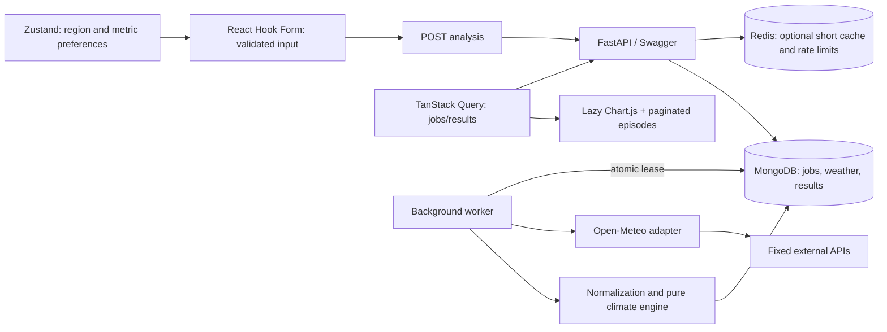

# System design and implementation walkthrough

## Boundaries

The UI has no climate algorithms and the climate engine has no database/network dependency. `models.py` owns canonical request validation/versioning; `provider.py` owns external access and normalization entry; `climate.py` owns deterministic detection and aggregation; `storage.py` owns Mongo persistence and durable worker coordination; `cache.py` owns optional Redis; `main.py` exposes HTTP contracts. The frontend separates `api.ts`, `store.ts`, forms/results and chart rendering.

TanStack Query owns response data, status, retry and query-key identity. Zustand only persists city/metric preferences. React Hook Form owns editable input and validation. This prevents stale copies of the same server data in multiple stores. A result labels its own coordinates/time range, so editing the form cannot silently relabel a previously computed result.

## Durable jobs instead of long HTTP requests

1. Normalize coordinates and validate complete years and span.
2. Hash the canonical request with the methodology version. Mongo `_id` enforces uniqueness.
3. Upsert a queued job; return 202 immediately. Existing completed jobs return the same stored result.
4. A worker atomically claims a queued/expired-lease job. Its unique lease token fences result writes; a stale worker cannot overwrite a newer owner's result.
5. Renew a 90-second lease every 20 seconds. A crashed process's job can be reclaimed. Graceful shutdown releases it. After repeated crashes, expose failure rather than endlessly retrying.
6. Fetch only missing weather years, persist them, then read the complete input from MongoDB.
7. Run the pure analysis using `asyncio.to_thread`, store annual summary and episodes, mark completed.
8. Browser polls every 1.5 seconds only while pending. No refresh of the page is required. Navigation does not cancel the durable job.

There is one embedded worker by default. Production can separate workers from HTTP replicas. Upstream concurrency is bounded per process, not globally; total replicas must respect the provider's quota. Different jobs sharing uncached years can still duplicate a fetch if workers run concurrently. A future per-weather-block distributed lease would avoid that; identical analysis jobs already deduplicate.

## MongoDB documents

| Collection | Identity | Contents | Expiration |
| --- | --- | --- | --- |
| `weather` | methodology + rounded lat/lon + year | daily normalized rows, quality markers, grid/source metadata, fetch timestamp | 30 days |
| `analyses` | SHA-256(methodology + canonical request) | request, status/progress, timestamps, attempts, lease token/deadline, annual result, episode list | 7 days |

Mongo's unique `_id` indexes enforce identities. An index on status/lease/created time supports job claims. TTL indexes clean expired cache entries; reads for raw-cache reuse also check expiration because TTL cleanup is asynchronous. Results remain small (≤41 annual rows). Episode arrays are held server-side and sliced by Mongo for bounded responses. Maximum request spans keep documents comfortably below Mongo's document-size limit for this workload.

The method version includes ERA5, UTC, baseline and algorithm version. Changing scientific semantics requires incrementing it so incompatible results cannot collide. Deployment operators can shorten TTLs or rotate the version if upstream data corrections must be reflected sooner.

## Cache responsibilities

| Layer | Purpose | Freshness |
| --- | --- | --- |
| Browser query cache | immediate revisits, shared requests, stable UI | 5 min; city search 1 hour |
| Redis (optional) | shared hot completed-job/city responses and rate limits | response TTL 60 sec; limit window 60 sec |
| Mongo analyses | durable reusable derived results | 7 days |
| Mongo weather | expensive raw historical-data reuse across date ranges | 30 days |

Redis is not a queue or a data source of record. Losing it does not lose jobs or weather. Cache misses go to Mongo. Rate limiting uses atomic INCR + expiry in Lua; on Redis failure a bounded process-local fallback is used. That fallback is explicitly weaker across multiple replicas. Backend request admission is rate limited even on cache hits.

## Data quality and honest interpretation

A fixed historical baseline avoids changing the definition with every query. An annual percentile is simple to explain but intentionally less sophisticated than a calendar-day seasonal threshold. Missing observations are not interpolated: doing so could invent or hide consecutive-day events. Duplicate days are quarantined, and physically implausible values are marked invalid. All excluded values and annual coverage are exposed.

Detection runs across year boundaries; frequency counts event starts, while days are allocated by year. The worker loads adjacent complete years where available. Outer-boundary episodes are explicitly flagged. A trailing mean requires five consecutive eligible years; a missing/ineligible year creates a gap. OLS requires ten eligible years, and endpoint comparisons require two non-overlapping five-year windows. No statistical significance or climate attribution is inferred.

## Security, limits, and failures

- Pydantic forbids extra fields, non-finite coordinates, invalid ranges and oversized year spans.
- Public callers cannot supply arbitrary upstream URLs. Redirects are disabled; requests use fixed HTTPS endpoints.
- POST JSON body limit 16 KiB, upstream body limit 4 MB; connection timeout 5 sec, HTTP operation timeout 30 sec; at most three attempts for selected transient errors.
- Analysis queue admission has a best-effort 100-active-job guard. It is not an atomic multi-tenant admission controller.
- Mongo errors yield 503; provider errors yield 502 for search or a failed analysis with a safe message. Unknown worker exceptions are logged server-side without exposing internals.
- Rate limiting keys use the observed peer address. At a proxy, explicitly configure trusted forwarding or enforce user/IP quotas at the gateway. Do not turn on blanket trust for arbitrary public forwarding headers.
- Database/Redis secrets belong in environment configuration and private networking. No secrets enter the frontend bundle.
- Swagger remains available for this assessment. If production policy requires it, restrict docs at the gateway.
- The source is public weather; there is no login/PII model. Public job IDs are deterministic and not authorization tokens.

## Scaling and operational tradeoffs

At this scope, a Mongo-backed queue avoids an extra broker and keeps the job API recoverable. It polls at 500 ms and stores bounded job payloads. At higher throughput, use a dedicated queue, lease metrics, dead-letter handling, account-level quotas, a global upstream request budget, retention policies and worker autoscaling. Separate provider fetching (I/O) from heavier future spatial calculations (process pool or dedicated compute service).

The API can scale horizontally with shared Mongo and Redis. The worker's process-local semaphore alone does not enforce a global external API budget. Reverse-proxy TLS, trusted proxy configuration, authentication for managed stores, egress controls and monitoring are deployment responsibilities. Mongo readiness is checked; Redis is optional and does not fail health. A platform that sleeps suspends embedded jobs until it wakes, so production workers need an always-on host.

## UI redesign path

The current CSS provides a readable, responsive shell only. Replace the visual layer in `App.tsx`, `Chart.tsx` and `styles.css` while keeping typed API contracts/query hooks and the backend untouched. Avoid putting server results into Zustand when adding navigation or controls. More complex designs can split the present form/result components into feature folders without changing ownership rules.

## Page navigation and browser-state ownership

- `/` is the React Hook Form selection page. Zustand persists the selected city (ID, name, coordinates), editable coordinates/year draft and city-search text. Editing coordinates clears the city label so a custom point is never mislabeled.
- Successful submission navigates to `/analyses/:id`. Queued/processing jobs show an accessible loader; results appear only on this page. The former `?analysis=` links redirect here.
- `/analyses/:id/episodes?page=2` is a separate episode page. URL pagination supports browser Back/Forward and shared links; Zustand remembers the most recently viewed page when entering without a page parameter.
- Zustand stores at most 20 analysis selection snapshots and their metric, annual-table expansion and episode-page preferences. Snapshots prevent a later city selection from relabeling an earlier analysis. A fresh browser without that metadata displays the actual coordinates from the server.
- TanStack Query owns result/status/episode JSON. Its shared cache survives route changes and expires after 30 inactive minutes. Refresh restores small preferences from localStorage and fetches persisted results from MongoDB; large result arrays are not serialized to browser storage.
- Unmounting cancels query requests through AbortSignal and removes polling observers. Form subscriptions and debounce timers have explicit cleanup; submission requests are aborted on selection-page unmount, with a guard against late navigation. Server jobs already accepted continue independently. Chart.js instances are cleaned up by the React chart wrapper when the results page unmounts.
- Cleanup regression tests cover an in-flight aborted request and queued-job polling stopping after navigation. This is targeted lifecycle verification, not a long-running heap-profile guarantee.

### City picker

The selected city name is also the persisted combobox input value. Suggestions use an absolutely positioned overlay with a bounded scrolling list, so loading and results do not move the form. ArrowDown/ArrowUp move the active option, Enter selects it, Escape dismisses it, and Tab leaves the control. ARIA combobox/listbox/option attributes expose the active option while keyboard focus stays in the input. Clearing resets the city and coordinates; typing a replacement removes the previous city label. Debouncing is cleaned up on unmount, stale-term results are hidden, and only an open search enables the query.
